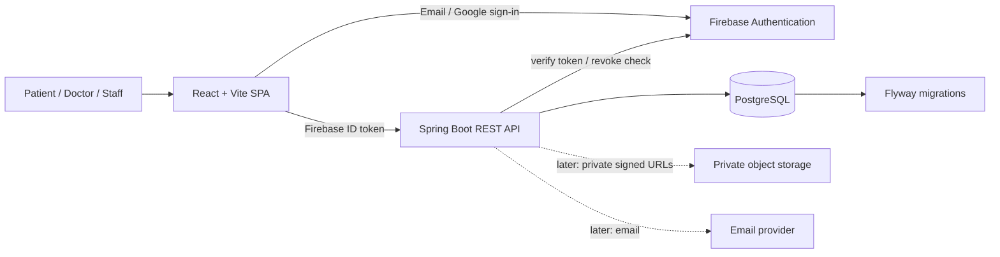
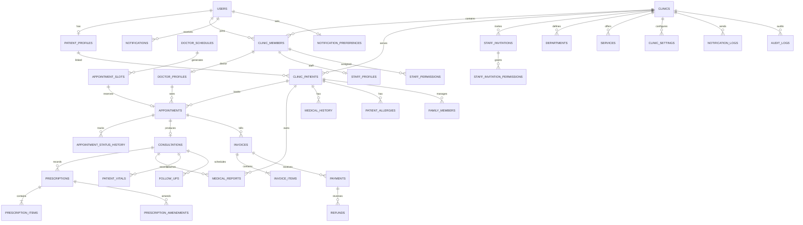

# Clinic Management System foundation

## Architecture

One React SPA talks to a stateless Spring Boot REST API. Firebase Authentication owns credentials and sign-in; PostgreSQL is the source of truth for application roles, clinic membership, and medical data. Flyway owns schema changes. The API verifies every Firebase ID token, resolves the UID to an enabled local user, and authorizes clinic data through memberships. Files stay in private object storage and are delivered through short-lived signed URLs when the medical-record module is added.



## Data model and ER diagram

All primary keys are UUIDs. Clinic-owned records carry `clinic_id`; composite foreign keys keep patient, doctor, appointment, and billing records inside the same clinic. `users` is the shared identity, `patient_profiles` is global, and `clinic_patients` links that patient to each clinic without duplicating their identity. Membership roles are stored by the server and never accepted from registration input. Amounts use `numeric(12,2)`, timestamps use `timestamptz`, and medical documents store private object keys rather than public URLs.

The complete PostgreSQL definition is `clinic-management-backend/src/main/resources/db/migration/V1__clinic_schema.sql`.



Schema modules: identity and clinics (`users`, `clinics`, `clinic_members`, `patient_profiles`, `doctor_profiles`, `staff_profiles`, `clinic_patients`, `family_members`, `staff_permissions`, `staff_invitations`, `staff_invitation_permissions`); scheduling (`doctor_schedules`, `schedule_breaks`, `appointment_slots`, `appointments`, `appointment_status_history`, `appointment_notes`); records (`consultations`, `patient_vitals`, `prescriptions`, `prescription_items`, `prescription_amendments`, `medical_reports`, `medical_history`, `patient_allergies`, `follow_ups`); finance (`invoices`, `invoice_items`, `payments`, `refunds`); operations (`notifications`, `notification_preferences`, `notification_logs`, `departments`, `services`, `clinic_settings`, `audit_logs`). The migration contains the columns, constraints, indexes, and relationships for each table. PostgreSQL range exclusion constraints reject overlapping doctor slots and active appointments, even when concurrent booking requests race; an active-slot unique index is an additional guard.

## Project layout

```text
clinic-management-frontend/
  src/
    app/              App and route composition
    auth/             Firebase auth context and protected routes
    components/       Shared buttons, forms, and layout
    layouts/          Patient, doctor, and staff shells
    pages/            Authentication and role dashboards
    services/         Axios API client
    styles/           Tailwind entry point
    utils/            Role routing helpers
clinic-management-backend/
  src/main/java/com/clinic/
    auth/             Registration and current-user API
    clinic/           Clinic and membership persistence
    patient/          Patient identity/profile
    security/         Firebase filter and API security
    config/           Firebase and application configuration
    common/           API errors and health endpoint
  src/main/resources/db/migration/  Flyway SQL
  src/test/java/com/clinic/         Focused service/security tests
docs/architecture.md
```

## Authentication and authorization

1. Email/password or Google sign-in happens in Firebase's modular web SDK. Passwords never reach Spring or PostgreSQL.
2. Axios obtains the current Firebase ID token and sends it as `Authorization: Bearer …`.
3. A stateless Spring Security filter verifies signature, issuer, audience, expiry, and revocation with Firebase Admin. It resolves the UID against `users` for all routes except the one-time/idempotent registration endpoint; disabled or unknown local accounts are denied.
4. Registration uses only the verified Firebase UID, email, and display name plus a validated patient name. It creates a patient account and cannot accept a role, UID, clinic, or permissions from the browser.
5. `/auth/me` returns server-resolved roles and clinic memberships. The SPA uses these only to select a dashboard; each API operation must independently enforce membership and permission in the backend.
6. Doctor bootstrap is an optional operator-controlled environment setting. Staff membership is created only by a later invitation flow. Staff permissions are never editable by staff themselves.

## API contracts

All API routes use `/api/v1`. JSON error responses have `{ "error": "…" }`. UUIDs identify resources; list endpoints added in later phases use `page`, `size`, `sort`, and explicit filters.

| Contract | Request / response | Access |
|---|---|---|
| `POST /auth/register` | `{fullName}` → current `UserSession`; authenticated Firebase ID token | Signed-in Firebase user |
| `GET /auth/me` | → `{id, fullName, email, roles, memberships}` | Active application user |
| `GET /health` | → `{status:"ok"}` | Public liveness |
| `GET/PUT /users/profile` | profile DTO; never UID or role | Own user |
| `GET /patients/doctors`, `GET /patients/doctors/{id}`, `GET /patients/doctors/{id}/slots?date=` | doctor/slot DTOs | Patient |
| `GET /patients/medical-history`, `/prescriptions`, `/reports`; `POST /patients/reports` | paged clinical DTOs / private upload metadata | Authorized patient |
| `POST /appointments`, `GET /appointments/my`, `GET /appointments/{id}`, `PATCH /appointments/{id}/cancel`, `/reschedule` | appointment DTO; slot is rechecked in a transaction | Patient or permitted staff |
| `GET /doctor/dashboard`, `/appointments`, `/patients`, `/patients/{id}` | paged/dashboard DTOs | Doctor membership |
| `POST /consultations`, `/prescriptions`, `/medical-reports` | validated clinical DTOs | Doctor membership |
| `POST /doctor/staff/invite`, `GET /doctor/staff`, `PUT /doctor/staff/{id}/permissions`, `DELETE /doctor/staff/{id}` | invitation / permission DTOs | Doctor membership |
| `PUT /doctor/schedule` | schedule DTO | Doctor membership |
| `GET /staff/dashboard`, `/appointments`, `/queue`; `POST /staff/patients`, `/staff/appointments`; `PATCH /staff/appointments/{id}/check-in` | paged operational DTOs | Staff permission |
| `POST /staff/invoices`, `/staff/payments`; `GET/POST /billing/invoices`, `POST /billing/payments` | invoice/payment DTOs | Billing permission |

## Dependencies

The frontend uses React, Vite, JavaScript, Tailwind CSS, React Router, Axios, React Hook Form, Zod, Lucide React, Recharts, Firebase JS SDK, and the Zod resolver. The backend foundation uses Java 21, Spring Boot 4.1, Spring Security, Spring Data JPA/Hibernate, Maven, Firebase Admin SDK, Jakarta Validation, PostgreSQL JDBC, Flyway, springdoc-openapi/Swagger UI, and Spring Boot test support. Local PostgreSQL is provided through Docker Compose. Secrets are environment variables or ADC credentials; no Firebase service account file is committed.

Later feature dependencies are kept out of the foundation until their workflows are implemented: an S3 client for private reports, a PDF renderer for prescriptions/invoices, Spring Mail plus an email provider for notifications, and a payment provider SDK only after the clinic selects a gateway. WhatsApp/SMS remain optional adapters.

## Roadmap

1. **Phase 1 — foundation (this delivery):** Vite SPA, Firebase sign-in, ID-token verification, account provisioning, PostgreSQL/Flyway, clinic-owner bootstrap, role-protected dashboard shells, setup documentation.
2. **Phase 2 — clinic and schedules:** clinic settings, patient/doctor directories, schedules, transactional slot booking and cancellation.
3. **Phase 3 — clinical records:** consultations, immutable finalized prescriptions and amendments, private reports, patient history and follow-ups.
4. **Phase 4 — staff operations:** invitations, fine-grained permissions, queue, check-in, audit events.
5. **Phase 5 — billing and notifications:** invoices, payments/refunds, receipts, email reminders and reporting.
6. **Release hardening:** jurisdiction-specific consent/retention review, rate limits, storage encryption, backup/restore, observability, deployment and integration tests.

No later-phase endpoint is represented as implemented merely because its contract or table exists. Clinical features remain unavailable until their authorization and workflows are built.
